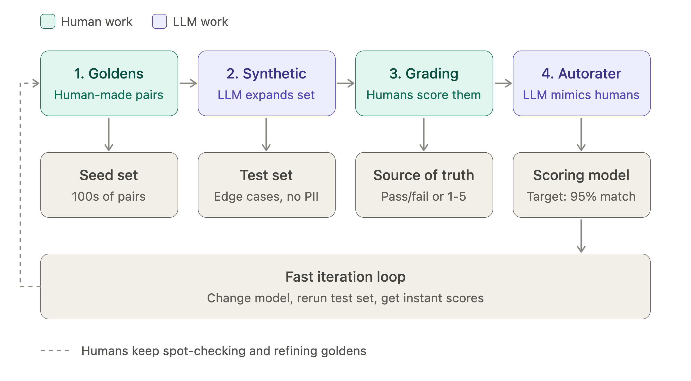

# braintrust-demo

A learning project for [Braintrust](https://www.braintrust.dev/docs) + AI Evals. For anyone who wants to learn more about how to use AI Evals in Product Management.

Follow along by using the [Braintrust Foundation Course](https://www.braintrust.dev/foundations)

## Practical Demo: BrainTrust Platform

- Eval question tested: which default AI model makes the best friend?
  - Three dimensions: collaborative planning, intellectual conversation, emotional attunement
- Workflow inside BrainTrust:
  1. Upload dataset (hand-written goldens + verified synthetic data)
  2. Create a prompt (kept simple, with response-length guardrails)
  3. Build a scorer/autorater with explicit rubric (bad = 0, okay = 0.5, great = 1)
  4. Run experiments per model (ChatGPT, Claude, Gemini, etc), visualize side by side
- Result: LLM scored best across naive prompts and autoraters
  - Challenges the assumption that one LLM feels most human over others
  - Latency and token cost also matter at scale
- Full loop: production signals → evals → improvements → back to production
  - BrainTrust combines evals and observability in one platform
  - Used by Ramp, Stripe, and Notion and more!


## Why AI Evals Matter for PMs




- Gen AI systems are nondeterministic: same input yields different outputs
- Traditional unit tests don’t work; evals assess correctness, quality, and tone
- Evals replace vague PRD specs (“be helpful”) with structured, measurable tests
  - Become the spec, acceptance criteria, and launch gate in one

## The Four-Step Eval System

**Step 1: Create goldens 🏅**
  - Human-curated input/output pairs covering key use cases and edge cases
  - Real product teams write hundreds of goldens
  - Examples for a customer service bot:
    - Input: refund request → output: friendly refund initiation
    - Input: angry message → output: escalate to human agent
    - Input: fraudulent request → output: politely refuse

**Step 2: Generate synthetic data 🤖**
  - Use an LLM to expand goldens into a larger test set
  - Covers typical, adversarial, and underrepresented scenarios
  - Avoids using real user PII

**Step 3: Grade outputs to define source of truth 📝**
  - Humans grade synthetic data across dimensions (e.g. accuracy, tone)
  - Can be binary pass/fail or a rubric (e.g. 1-5 scale)
  - Industry metrics: FID for image generation, ROUGE for text

**Step 4: Build an autorater ⚙️**
  - Secondary LLM grades the primary system’s outputs
  - Target: 95% alignment with human-graded outputs
  - Spot-checking by humans continues; goldens are refined over time
  - Enables fast iteration


# Sample dataset

`dataset/customer_support_messages.csv` is a 100-row mock inbox for the [simple eval in the Braintrust UI](https://www.braintrust.dev/foundations/build-a-simple-eval-in-braintrust-ui). To change a message, edit `scripts/generate_customer_support_dataset.py` and regenerate:

```bash
python scripts/generate_customer_support_dataset.py
```

The top of that script lists the columns and how to map them when you upload.


