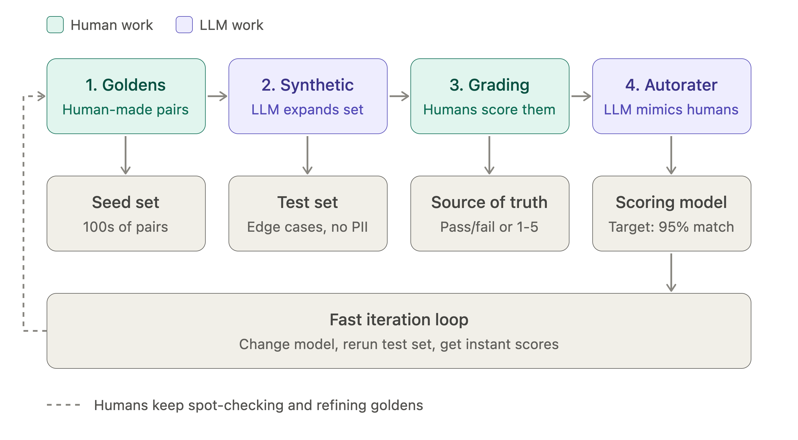

# braintrust-demo

A hands-on learning project for [Braintrust](https://www.braintrust.dev/docs) and AI evals, aimed at PMs and builders who want a practical path from "why evals?" to an improvement loop in production.

Follow along with the [Braintrust Foundations course](https://www.braintrust.dev/foundations). For the mental model behind the work here, read [AI Evals: Getting started with Evals](https://medium.com/@STB_90/getting-started-with-evals-a-step-by-step-guide-leveraging-bottom-up-error-analysis-and-llm-judge-3d9b755824a7) by Stephan Beyer (building on [Hamel Husain](https://hamel.dev)).

## Why evals matter

Traditional software is **deterministic**: the same input produces the same output from fixed logic. LLMs are **probabilistic**: they produce what is most likely, not what is guaranteed.

That means you cannot ship an AI feature by writing a unit test that asserts one exact string. You need evals: a systematic way to measure whether the model behaves the way you expect, and where it falls short. For PMs, evals replace vague PRD language ("be helpful") with measurable acceptance criteria and a launch gate.



## Start bottom-up, not top-down

The common mistake is inventing a list of scorers before you know what is broken. The blog above argues for the opposite: **read real conversations first**, then decide which evals you need.

| Step | What you do | What this repo practices |
| --- | --- | --- |
| 1. Prepare traces | Export conversations between users and the AI | `module_3` CSV, then production-style logs in `module_10`–`module_13` |
| 2. Open coding | A human labels what went wrong in each row | You (and later Topics) read failures before automating |
| 3. Axial coding | Group those labels into patterns | Topics / heatmaps: unfriendly tone, missing handoff, not helpful |
| 4. Choose evals | Pick scorers from frequency and severity | Brand Alignment, Conversation Quality |
| 5. LLM judge | Binary pass/fail beats a fuzzy 1–5 when you need a ship decision | Scorers return A/B/C or Y/N |
| 6. Calibrate | Disagreements between human labels and the judge are the signal | Iterate the judge prompt, then the product prompt (`module_14`) |

Key ideas from that guide that apply here:

- **Humans do the first pass.** Handing traces to an LLM before you have read them yourself flies blind.
- **Binary judges stay actionable.** TRUE/FALSE (or Y/N) forces a release decision. A score of 3.5/5 does not.
- **Disagreements are gold.** When the judge and a human disagree, refine the rubric. Do not paper over the gap with a higher average.
- **You can start in a spreadsheet.** Fancy tooling helps at scale; intuition starts with reading the data.

## What this repo is

A customer-support agent project on **SDK Customer Support bot** in Braintrust. Modules move from offline evals → logging → online scoring → Topics → an improvement loop.

| Module | What you practice |
| --- | --- |
| [`module_3`](module_3/) | Golden + synthetic dataset for a simple UI eval |
| [`module_6`](module_6/) | Offline eval with a Brand Alignment LLM judge |
| [`module_7`](module_7/) | Same eval with trials (temperature / variance) |
| [`module_10`](module_10/) | Chat app that logs multi-turn traces |
| [`module_11`](module_11/) | Score existing traces (script + UI scorer) |
| [`module_12`](module_12/) | Online scoring automations on new logs |
| [`module_13`](module_13/) | Bulk production-style logs for Topics |
| [`module_14`](module_14/) | Dataset from failing logs → prompt change → compare experiments |

Each module folder has its own README, `requirements.txt`, and a local `.venv` via `uv`. Scripts read `BRAINTRUST_API_KEY` and `GEMINI_API_KEY` from the environment. Do not commit keys.

## The full loop in Braintrust

1. **Offline eval** — curated dataset, prompt, scorer, experiment (`module_6`, `module_7`).
2. **Observe** — log real or simulated traffic (`module_10`, `module_13`).
3. **Online score** — automations grade new traces as they land (`module_12`).
4. **Discover** — Topics / facets cluster failure modes from volume (`module_13`).
5. **Improve** — promote bad traces into a dataset, change the prompt, re-run (`module_14`).

That is the same production loop the Foundations course teaches: production signals → evals → improvements → back to production.

## Sample dataset

[`module_3/dataset/customer_support_messages.csv`](module_3/dataset/customer_support_messages.csv) is a 100-row mock inbox for the [simple eval in the Braintrust UI](https://www.braintrust.dev/foundations/build-a-simple-eval-in-braintrust-ui). To change a message, edit [`module_3/scripts/generate_customer_support_dataset.py`](module_3/scripts/generate_customer_support_dataset.py) and regenerate:

```bash
cd module_3
python scripts/generate_customer_support_dataset.py
```

The top of that script lists the columns and how to map them on upload.

## How to use this repo

1. Read the [evals getting-started guide](https://medium.com/@STB_90/getting-started-with-evals-a-step-by-step-guide-leveraging-bottom-up-error-analysis-and-llm-judge-3d9b755824a7) so the bottom-up framing is clear (~15 minutes).
2. Work the [Braintrust Foundations](https://www.braintrust.dev/foundations) lessons in order, using the matching `module_*` folder here.
3. When a module needs Google Gemini, open that folder's README, create a `.venv` with `uv`, set the two API keys, and run the listed command.

## Further reading

- [AI Evals: Getting started with Evals](https://medium.com/@STB_90/getting-started-with-evals-a-step-by-step-guide-leveraging-bottom-up-error-analysis-and-llm-judge-3d9b755824a7) — bottom-up error analysis and LLM judges
- [Hamel Husain](https://hamel.dev) — deeper eval practice and tooling guidance
- [Braintrust docs](https://www.braintrust.dev/docs) — platform reference for datasets, experiments, online scoring, and Topics
